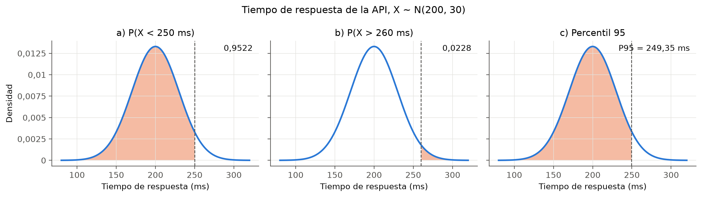
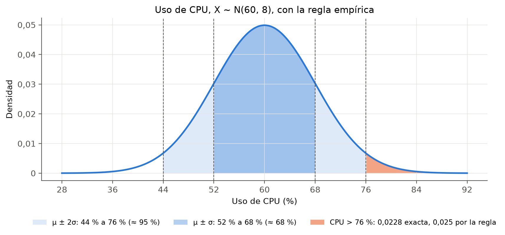
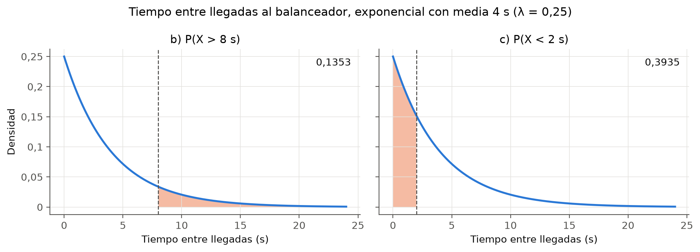
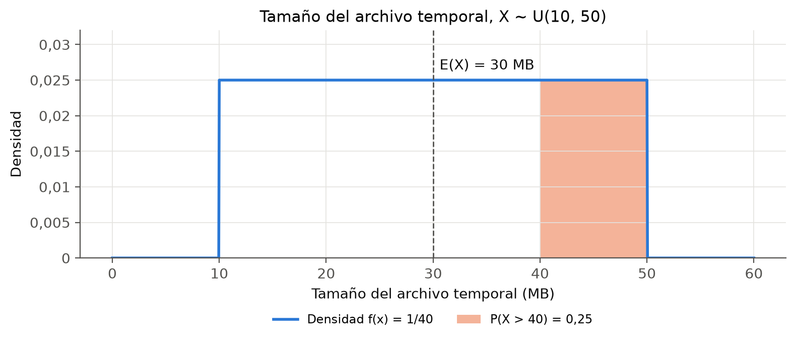
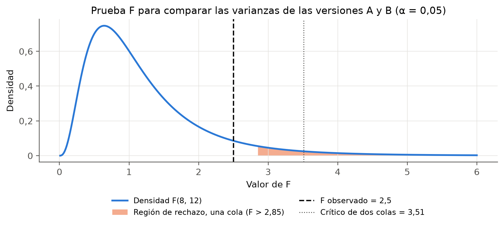
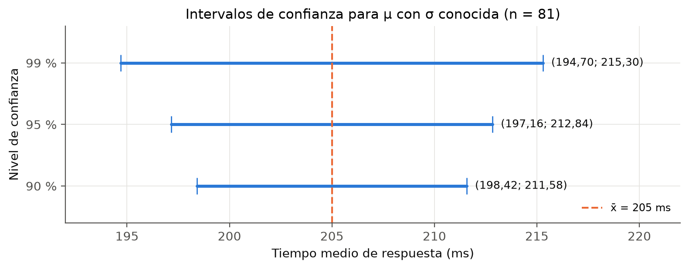
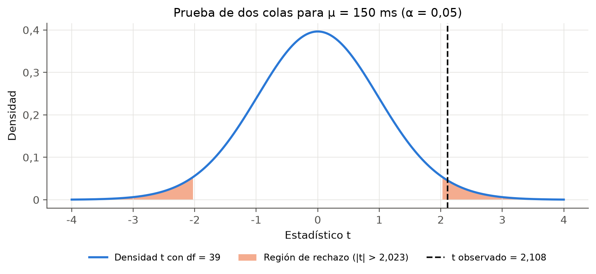
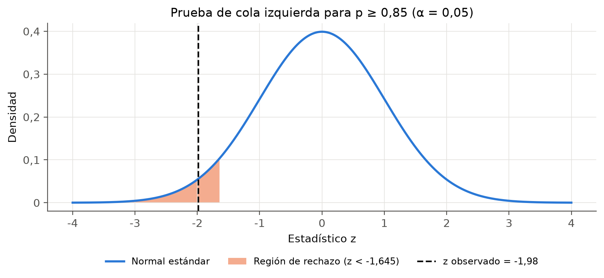
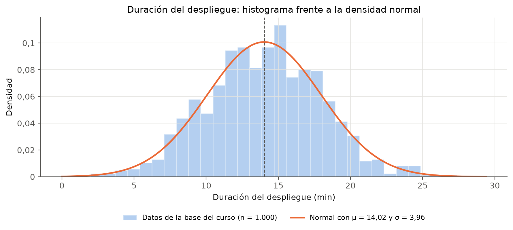

# Actividad de la Unidad 3: distribuciones continuas, estimación y prueba de hipótesis

## Presentación

| | |
|---|---|
| **Universidad** | Universidad de Cartagena |
| **Centro tutorial** | Cereté, Córdoba, Colombia |
| **Programa** | Ingeniería de Software |
| **Asignatura** | Probabilidad y Estadística |
| **Actividad** | Actividad de la Unidad 3: distribuciones continuas, estimación y prueba de hipótesis |
| **Autor** | Jairo Alonso Osorio Cruz |
| **Semestre** | VI |

En este repositorio está el desarrollo completo de la actividad y el notebook de Python con el que verifiqué cada ejercicio.

### Contenido del repositorio

```
README.md    este documento, con el desarrollo completo de la actividad
data/        CFBD273_Base_de_Datos_1000_registros.xlsx, la base de datos del curso
notebooks/   actividad_unidad_3.ipynb, el notebook ejecutado con sus salidas
figures/     las gráficas que genera el notebook
requirements.txt
```

### Cómo ejecutar el notebook

Trabajé en macOS con Python 3.13, en Jupyter dentro de PyCharm.

```bash
python3 -m venv .venv
source .venv/bin/activate
pip install -r requirements.txt
jupyter notebook notebooks/actividad_unidad_3.ipynb
```

También se puede abrir el notebook directamente en PyCharm y elegir el `.venv` como intérprete. Las rutas se calculan desde la carpeta del notebook, así que funciona sin importar dónde se clone el repositorio. La muestra del ejercicio 14 usa la semilla 2026, de modo que los resultados son siempre los mismos. Las versiones exactas de las librerías están en `requirements.txt`.

## Introducción

En el desarrollo de software casi nunca se puede medir todo. No se registran todas las peticiones posibles de una API, no se revisan todos los módulos de un sistema ni se encuesta a todos los usuarios de una aplicación. Lo que el equipo tiene son muestras: unas cuantas mediciones de rendimiento, algunos despliegues o una encuesta. Con ellas tiene que decidir cuánto prometer en un acuerdo de nivel de servicio, cuándo disparar una alerta o si una versión nueva de verdad mejoró algo.

Esta actividad recorre las herramientas de la Unidad 3 que permiten pasar de esas muestras a conclusiones sobre el sistema completo. Primero modelo variables continuas con las distribuciones normal, exponencial y uniforme. Luego trabajo con las distribuciones de muestreo t de Student, ji-cuadrada y F, y con los tipos de muestreo. Después construyo intervalos de confianza para medias y proporciones, calculo tamaños de muestra y hago pruebas de hipótesis de una y dos colas. Al final aplico todo a la columna Duracion_Despliegue_min de la base de datos del curso.

Cada ejercicio lo resolví a mano, con las fórmulas y los valores de tabla, y lo verifiqué en Python con numpy, scipy, pandas y matplotlib. El enunciado sugiere Google Colab; yo trabajé en Jupyter dentro de PyCharm, con el mismo código. El notebook, la base de datos y las figuras están en este mismo repositorio.

## Objetivos

### Objetivo general

Aplicar las distribuciones continuas, la estimación por intervalos y la prueba de hipótesis a problemas de la ingeniería de software, resolviendo los ejercicios con procedimiento justificado, verificándolos con Python e interpretando los resultados en el contexto del software.

### Objetivos específicos

- Calcular probabilidades y percentiles con las distribuciones normal, exponencial y uniforme, y usarlos para definir acuerdos de nivel de servicio, umbrales de alerta, tiempos de espera y capacidad de almacenamiento.
- Distinguir cuándo se usan las distribuciones t de Student, ji-cuadrada y F, y los tipos de muestreo probabilístico y no probabilístico, a partir de ejemplos propios del desarrollo de software.
- Construir intervalos de confianza para medias y proporciones, calcular tamaños de muestra y realizar pruebas de hipótesis, explicando cada decisión con el valor crítico y el valor p.
- Analizar con Python la duración de los despliegues de la base de datos del curso, comparando su distribución con la normal, estimando su media y contrastándola con una meta del equipo.

## Justificación

Un ingeniero de software toma decisiones con datos incompletos todo el tiempo. Si promete en un SLA un tiempo de respuesta que solo cumple la mitad de las peticiones, incumple el contrato; si pone una alerta de CPU en un umbral que se supera a diario, el equipo termina ignorándola; si declara que una versión nueva es más estable con nueve mediciones, puede estar celebrando una casualidad. Las herramientas de esta unidad sirven justamente para evitar esos errores, porque permiten cuantificar la incertidumbre y saber cuándo una diferencia es real y cuándo puede deberse al azar del muestreo.

Por eso la actividad no se queda en el cálculo. Cada resultado lo traduzco a una decisión concreta: qué tiempo prometer, dónde poner una alarma, cuántos usuarios encuestar, si un indicador interno es creíble. Verificar todo en Python también tiene un propósito práctico, porque es la forma en que estos análisis se hacen en un equipo de desarrollo real y porque deja el procedimiento reproducible para que otra persona lo revise.

## Marco teórico

### Distribución normal y estandarización

La distribución normal describe una variable aleatoria continua, que puede tomar cualquier valor dentro de su campo de variación (Martínez Bencardino, 2018, p. 247). Su curva es simétrica, tiene un área total de 100 %, es asintótica al eje horizontal y deja el 50 % del área a cada lado de la media. Para calcular áreas se estandariza con z = (X − μ)/σ, que indica a cuántas desviaciones de la media está un valor; entre z = −3 y z = +3 queda el 99,7 % del área (Martínez Bencardino, 2018, p. 249). La regla empírica resume ese comportamiento: alrededor del 68 % de los datos está a una desviación de la media, el 95 % a dos y el 99,7 % a tres (Illowsky y Dean, 2022, sección 6.1).

### Distribuciones uniforme y exponencial

La distribución uniforme continua describe eventos que tienen la misma probabilidad de ocurrir dentro de un intervalo [a, b] (Illowsky y Dean, 2022, sección 5.2). La exponencial describe el tiempo que transcurre hasta que ocurre un evento; su parámetro es m = 1/μ y tiene la propiedad de falta de memoria, según la cual el tiempo que ya pasó no cambia la probabilidad del tiempo que falta (Illowsky y Dean, 2022, sección 5.3).

### Muestreo

El muestreo es el conjunto de métodos para obtener una muestra finita de una población finita o infinita, con el fin de estimar parámetros o contrastar hipótesis, y puede ser aleatorio o probabilístico, o no aleatorio o no probabilístico (Universidad de Cartagena, s.f.-b). Se recurre a la muestra porque el costo, el tiempo o el tamaño de la población impiden hacer un censo (Martínez Bencardino, 2018, p. 275). Entre los métodos aleatorios están el simple, el sistemático, el estratificado y el de conglomerados, y entre los no aleatorios el de juicio, el de conveniencia y el de cuotas (Martínez Bencardino, 2018, pp. 275-277). Cuando algunos miembros de la población no tienen la misma probabilidad de ser elegidos hay sesgo de muestreo, y las conclusiones sobre la población pueden ser incorrectas (Illowsky y Dean, 2022, sección 1.2).

### Distribución muestral de la media y estimación

Por el Teorema del Límite Central, al aumentar el tamaño de la muestra las medias muestrales tienden a una distribución normal con la misma media de la población y desviación σ/√n (Illowsky y Dean, 2022, secciones 7.1 y 7.3). Esa desviación se llama error estándar de la media (Martínez Bencardino, 2018, pp. 278-279). Una estimación por intervalo tiene la forma estimación puntual ± margen de error, y el nivel de confianza es el porcentaje de intervalos que contienen el parámetro cuando se repite el muestreo (Illowsky y Dean, 2022, sección 8.1). Para calcular un tamaño de muestra se despeja n de la fórmula del margen de error; con proporciones, P = 0,50 da el tamaño máximo y el resultado siempre se redondea al entero superior (Martínez Bencardino, 2018, pp. 303-304).

### Distribuciones de muestreo t, ji-cuadrada y F

La t de Student se usa cuando σ es desconocida y se reemplaza por s. Fue publicada por Gosset en 1908 con el seudónimo "Student", se aplica sobre todo a muestras pequeñas y forma una familia de curvas que depende de los grados de libertad v = n − 1 (Martínez Bencardino, 2018, pp. 351-352; Illowsky y Dean, 2022, sección 8.2). La ji-cuadrada tiene grados de libertad que dependen de cómo se use (Illowsky y Dean, 2022, sección 11.1): en la prueba de independencia son (filas − 1)(columnas − 1) (sección 11.3), y en la prueba de una varianza son n − 1, con el supuesto de una muestra aleatoria de una población normal (Martínez Bencardino, 2018, pp. 404-405). La F compara dos varianzas mediante su cociente; no es simétrica, lleva la varianza mayor en el numerador y tiene dos grados de libertad, v₁ = n₁ − 1 y v₂ = n₂ − 1 (Martínez Bencardino, 2018, pp. 410-411).

### Prueba de hipótesis

Una prueba de hipótesis contrasta dos afirmaciones opuestas sobre la población: la hipótesis nula, que siempre lleva el signo igual, y la alternativa, que es lo que normalmente se quiere probar (Illowsky y Dean, 2022, sección 9.1). Al decidir se pueden cometer dos errores: el tipo I, rechazar una hipótesis nula verdadera, cuya probabilidad es el nivel de significación, y el tipo II, no rechazar una hipótesis nula falsa (Martínez Bencardino, 2018, p. 326). En una prueba unilateral la región crítica está en un solo extremo y se usa todo α; en una bilateral α se reparte entre las dos colas (Martínez Bencardino, 2018, p. 328). La decisión se puede tomar comparando el estadístico con el valor crítico o comparando el valor p con α (Illowsky y Dean, 2022, sección 9.5).

## Desarrollo

### Subtema 1. Distribuciones continuas

#### Ejercicio 1. Normal y estandarización

**Datos del problema.** El tiempo de respuesta X de una API se distribuye normal con media μ = 200 ms y desviación estándar σ = 30 ms. El dato viene de miles de peticiones registradas durante una semana.

**Distribución y por qué.** Uso la distribución normal porque el enunciado la da como modelo del tiempo de respuesta y porque es una variable continua, que puede tomar cualquier valor dentro de un rango. Martínez Bencardino (2018, p. 247) presenta la normal como la distribución de una variable continua, y entre las condiciones de la curva señala que es simétrica, que la media está en el centro con el 50 % del área a cada lado y que cualquier valor se lleva a la normal estándar con z (p. 249). Así puedo usar una sola tabla, la de Z ~ N(0, 1), para cualquier media y desviación (Illowsky y Dean, 2022, sección 6.1).

**Fórmula.**

z = (x − μ) / σ

P(X < x) = P(Z < z) = Φ(z)  y  P(X > x) = 1 − Φ(z)

Para el percentil: x = μ + z·σ

**Desarrollo.**

a) P(X < 250)

z = (250 − 200) / 30 = 50 / 30 = 1,67 (1,6667 sin redondear)

En la tabla de la normal estándar, Φ(1,67) = 0,9525. Entonces P(X < 250) ≈ 0,9525. Con z sin redondear el valor exacto es 0,9522; la diferencia de tres milésimas viene de redondear z a dos decimales para entrar a la tabla.

b) P(X > 260)

z = (260 − 200) / 30 = 60 / 30 = 2,00

En la tabla, Φ(2,00) = 0,9772. Como se pide la cola derecha, P(X > 260) = 1 − 0,9772 = 0,0228.

c) Percentil 95

Busco en la tabla el z que deja 0,95 a la izquierda. El valor 0,95 queda entre Φ(1,64) = 0,9495 y Φ(1,65) = 0,9505, justo en el punto medio, así que tomo z = 1,645.

x = 200 + 1,645 · 30 = 200 + 49,35 = 249,35 ms

**Resultado.** a) P(X < 250) ≈ 0,9522. b) P(X > 260) ≈ 0,0228. c) P95 ≈ 249,35 ms.

**Verificación con Python.** Con scipy.stats.norm(200, 30): cdf(250) = 0,9522 con z = 1,6667; sf(260) = 0,0228 con z = 2; ppf(0,95) = 249,3456 ms con z = 1,6449. El notebook también muestra los valores de tabla Φ(1,67) = 0,9525, Φ(1,64) = 0,9495 y Φ(1,65) = 0,9505, que coinciden con los que usé a mano.



**Interpretación.** Cerca del 95,2 % de las peticiones responde en menos de 250 ms, y solo unas 23 de cada 1.000 pasan de 260 ms. Como el percentil 95 está en 249,35 ms, el equipo puede ofrecer un SLA de "el 95 % de las peticiones responde en menos de 250 ms" con un pequeño margen a favor. Prometer 200 ms sería un error: es la media, así que la mitad de las peticiones la superaría. Las peticiones por encima de 260 ms son pocas, pero en un servicio con miles de peticiones al día son cientos de casos, y conviene vigilarlas con una alerta sobre el percentil y no sobre el promedio.

#### Ejercicio 2. Regla empírica

**Datos del problema.** El uso de CPU X de un servidor de producción se distribuye normal con media μ = 60 % y desviación σ = 8 %, según los registros históricos del monitoreo.

**Distribución y por qué.** El enunciado da la normal como modelo y pide usar la regla empírica. Esa regla dice que en una distribución normal cerca del 68 % de los valores queda a una desviación de la media, cerca del 95 % a dos desviaciones y cerca del 99,7 % a tres (Illowsky y Dean, 2022, sección 6.1). Martínez Bencardino (2018, p. 249) señala lo mismo para el tercer caso, cuando z va de −3 a +3. La regla sirve para fijar umbrales rápidos sin tabla, porque solo pide la media y la desviación.

**Fórmula.**

μ ± 1σ contiene ≈ 68 % de las observaciones

μ ± 2σ contiene ≈ 95 % de las observaciones

z = (x − μ) / σ

**Desarrollo.**

a) Rango del 68 %: μ ± σ = 60 ± 8, es decir, de 52 % a 68 %.

b) Rango del 95 %: μ ± 2σ = 60 ± 2 · 8 = 60 ± 16, es decir, de 44 % a 76 %.

c) P(X > 76). Primero estandarizo: z = (76 − 60) / 8 = 2. El valor 76 % está justo a dos desviaciones por encima de la media. Por la regla empírica, fuera del intervalo de 44 % a 76 % queda el 5 % de las observaciones, y como la curva es simétrica se reparte por mitades entre las dos colas:

P(X > 76) ≈ (1 − 0,95) / 2 = 0,025

Con la tabla, Φ(2,00) = 0,9772, así que el valor exacto es 1 − 0,9772 = 0,0228. La diferencia se debe a que la regla redondea al 95 % un área que en realidad es 95,45 %.

**Resultado.** a) De 52 % a 68 %. b) De 44 % a 76 %. c) P(X > 76) ≈ 0,025 por la regla empírica y 0,0228 con la normal exacta.

**Verificación con Python.** Con scipy.stats.norm(60, 8): el área exacta entre 52 y 68 es 0,6827, entre 44 y 76 es 0,9545, y sf(76) = 0,0228 con z = 2.



**Interpretación.** El rango de 52 % a 68 % describe el comportamiento típico del servidor y no debería disparar ninguna alerta: un 16 % de las mediciones supera el 68 %, así que una alerta en ese punto sonaría varias veces al día sin que pase nada. El límite de 76 % sí funciona como umbral de alerta de saturación, porque en operación normal solo lo supera cerca del 2,5 % de las mediciones. Si la CPU se mantiene por encima de 76 % durante varias mediciones seguidas, lo más probable es que el servidor ya no esté en su comportamiento habitual y que el equipo deba escalar recursos o revisar qué proceso está consumiendo de más antes de que los usuarios noten la lentitud.

#### Ejercicio 3. Exponencial

**Datos del problema.** El tiempo X entre llegadas de peticiones a un balanceador de carga sigue una distribución exponencial con media μ = 4 s, medida en las horas de mayor tráfico.

**Distribución y por qué.** Uso la exponencial porque el enunciado la da como modelo y porque describe el tiempo que pasa hasta que ocurre un evento, en este caso la siguiente petición (Illowsky y Dean, 2022, sección 5.3). En ese libro el parámetro de decaimiento se escribe m = 1/μ; en este ejercicio lo llamo λ, la tasa de llegadas. Otra propiedad importante de la exponencial es la falta de memoria: el tiempo que ya pasó no cambia la probabilidad de lo que falta (sección 5.3).

**Fórmula.**

λ = 1 / μ

P(X > x) = e^(−λx)

P(X < x) = 1 − e^(−λx)

**Desarrollo.**

a) λ = 1 / 4 = 0,25 llegadas por segundo. En promedio llega una petición cada 4 s, o 0,25 peticiones por segundo.

b) P(X > 8) = e^(−0,25 · 8) = e^(−2) = 0,1353

c) P(X < 2) = 1 − e^(−0,25 · 2) = 1 − e^(−0,5) = 1 − 0,6065 = 0,3935

**Resultado.** a) λ = 0,25 llegadas/s. b) P(X > 8) ≈ 0,1353. c) P(X < 2) ≈ 0,3935.

**Verificación con Python.** Con scipy.stats.expon(scale = 4): sf(8) = 0,1353 y cdf(2) = 0,3935. Como apoyo para la interpretación, el notebook muestra que P(X > 13 | X > 5) = 0,1353, igual que P(X > 8), lo que confirma la falta de memoria, y que el percentil 99 del tiempo entre llegadas es 18,42 s.



**Interpretación.** En horas pico hay mucha actividad, porque el 39,35 % de las veces la siguiente petición llega en menos de 2 s. Aun así, en el 13,5 % de los intervalos pasan más de 8 s sin peticiones. Si el balanceador cerrara las conexiones inactivas a los 8 s, cortaría conexiones con frecuencia y obligaría a los clientes a abrirlas de nuevo, lo que agrega latencia. Por la falta de memoria, el tiempo que una conexión lleva esperando no dice nada sobre cuánto falta para la próxima petición, así que no tiene sentido "esperar un poco más porque ya casi llega". El timeout se debe fijar con la cola de la distribución: 18,42 s solo se supera en el 1 % de los intervalos, y un valor de ese orden evita los descartes prematuros sin dejar conexiones abiertas indefinidamente.

#### Ejercicio 4. Uniforme

**Datos del problema.** En un sistema de procesamiento por lotes, el tamaño X de un archivo temporal se distribuye uniforme entre a = 10 MB y b = 50 MB.

**Distribución y por qué.** Uso la uniforme continua porque el enunciado indica que cualquier tamaño entre 10 y 50 MB es igual de probable, y esa es la definición de esta distribución: eventos con la misma probabilidad dentro de un intervalo, X ~ U(a, b) (Illowsky y Dean, 2022, sección 5.2). Su densidad es constante, f(x) = 1/(b − a) = 1/40.

**Fórmula.**

E(X) = (a + b) / 2

Var(X) = (b − a)² / 12

P(X > x) = (b − x) / (b − a)

**Desarrollo.**

a) E(X) = (10 + 50) / 2 = 60 / 2 = 30 MB

b) Var(X) = (50 − 10)² / 12 = 1.600 / 12 = 133,33 MB². La desviación estándar es √133,33 = 11,55 MB.

c) P(X > 40) = (50 − 40) / (50 − 10) = 10 / 40 = 0,25

**Resultado.** a) 30 MB. b) 133,33 MB² (desviación de 11,55 MB). c) 0,25.

**Verificación con Python.** Con scipy.stats.uniform(loc = 10, scale = 40): mean() = 30,0, var() = 133,33, std() = 11,55 y sf(40) = 0,25.



**Interpretación.** Un archivo temporal ocupa en promedio 30 MB, pero los tamaños se reparten de forma pareja en todo el rango y uno de cada cuatro supera los 40 MB. El promedio sirve para estimar el consumo acumulado cuando se generan muchos archivos, por ejemplo cien archivos ocuparían alrededor de 3.000 MB. Para el espacio que debe estar libre en cada momento conviene reservar con el máximo, porque el tamaño nunca supera 50 MB: si el lote corre cinco procesos al mismo tiempo, 250 MB alcanzan siempre, sin sobredimensionar el servidor.

### Subtema 2. Distribuciones de muestreo

#### Ejercicio 5. t de Student, ji-cuadrada y F

**a) Distribución t de Student.**

Ejemplo propio: quiero estimar el tiempo medio que tarda el pipeline de integración continua de mi proyecto. Solo tengo 12 ejecuciones registradas de la última semana y no conozco la desviación estándar de todas las ejecuciones posibles, así que uso la desviación de la muestra.

Grados de libertad: df = n − 1 = 12 − 1 = 11.

Situación de uso: la t se usa para estimar o contrastar una media cuando σ es desconocida y se reemplaza por s. Martínez Bencardino (2018, pp. 351-352) explica que Gosset la publicó en 1908 con el seudónimo "Student", que se aplica a muestras pequeñas (n ≤ 30), que es una familia de distribuciones y que cada una depende de los grados de libertad v = n − 1. Illowsky y Dean (2022, sección 8.2) agregan que, a medida que crecen los grados de libertad, la curva t se parece cada vez más a la normal.

**b) Distribución ji-cuadrada.**

Ejemplo propio: quiero saber si el resultado de las pruebas automatizadas (pasó o falló) depende del lenguaje del módulo. En la base del curso hay cinco lenguajes (Python, Java, JavaScript, Go y C#) y dos resultados, así que los datos se organizan en una tabla de contingencia de 5 × 2.

Grados de libertad: df = (filas − 1)(columnas − 1) = (5 − 1)(2 − 1) = 4.

Situación de uso: es la prueba de independencia. La hipótesis nula dice que los dos factores son independientes y la alternativa que no lo son; el valor esperado de cada celda se calcula como (total de la fila)(total de la columna)/total, cada valor esperado debe ser al menos cinco y la prueba siempre es de cola derecha (Illowsky y Dean, 2022, sección 11.3). La ji-cuadrada también se usa para una sola varianza, por ejemplo para saber si la variabilidad del tiempo de respuesta supera un límite; en ese caso los grados de libertad son n − 1 y se supone una muestra aleatoria de una población normal (Martínez Bencardino, 2018, pp. 404-405). Los grados de libertad de la ji-cuadrada dependen de cómo se utilice (Illowsky y Dean, 2022, sección 11.1).

**c) Distribución F de Fisher.**

Ejemplo propio: tengo el mismo servicio desplegado en dos servidores con configuraciones distintas. Mido el tiempo de respuesta 16 veces en el primero y 21 veces en el segundo, y quiero saber si uno de los dos es más inestable que el otro.

Grados de libertad: v₁ = n₁ − 1 = 15 para el numerador y v₂ = n₂ − 1 = 20 para el denominador.

Situación de uso: la F compara dos varianzas mediante su cociente. Martínez Bencardino (2018, pp. 410-411) explica que no es simétrica, que en la tabla la varianza mayor va en el numerador y la menor en el denominador, y que los grados de libertad son v₁ = n₁ − 1 y v₂ = n₂ − 1. Illowsky y Dean (2022, secciones 13.2 a 13.4) la presentan como un cociente con dos conjuntos de grados de libertad que se usa para comparar varianzas y en el análisis de varianza.

**Por qué la pregunta decide la distribución.** Cada distribución de muestreo describe cómo se comporta un estadístico distinto. Si la pregunta es por una media, el estadístico es x̄ estandarizado con s, y su distribución es t. Si la pregunta es si dos variables categóricas están relacionadas, el estadístico suma las diferencias al cuadrado entre lo observado y lo esperado, y esa suma sigue una ji-cuadrada. Si la pregunta es si dos varianzas son iguales, el estadístico es un cociente de varianzas, y ese cociente sigue una F. Usar una distribución que no corresponde a la pregunta da valores críticos y valores p equivocados.

| Pregunta | Estadístico | Distribución | Grados de libertad |
|---|---|---|---|
| Estimar o contrastar una media con σ desconocida | t = (x̄ − μ) / (s/√n) | t de Student | n − 1 |
| Contrastar independencia entre dos variables categóricas | χ² = Σ (O − E)² / E | Ji-cuadrada | (filas − 1)(columnas − 1) |
| Contrastar una varianza | χ² = (n − 1)s² / σ² | Ji-cuadrada | n − 1 |
| Comparar dos varianzas | F = s₁² / s₂² | F de Fisher | n₁ − 1 y n₂ − 1 |

**Verificación con Python.** El notebook calcula los grados de libertad de los tres ejemplos: 11 para la t, 4 para la ji-cuadrada, contando con nunique() las categorías de Lenguaje y Resultado_Prueba en la base, y 15 y 20 para la F.

#### Ejercicio 6. Comparación de varianzas con F

**Datos del problema.** Versión A: s²_A = 45 con n_A = 9. Versión B: s²_B = 18 con n_B = 13. El equipo quiere saber si la nueva versión estabilizó los tiempos de respuesta. El enunciado no dice cuál es la nueva; tomo la versión A como la anterior y la B como la nueva, y como la B tiene la varianza menor, la pregunta es si esa reducción es significativa.

**Distribución y por qué.** Uso la distribución F porque se comparan dos varianzas y el estadístico es su cociente (Martínez Bencardino, 2018, pp. 410-411; Illowsky y Dean, 2022, secciones 13.2 a 13.4). Como supuestos, asumo que los tiempos de respuesta de cada versión son aproximadamente normales y que las dos muestras son independientes.

**Hipótesis.** "Estabilizar" significa reducir la variabilidad, así que planteo una prueba de una cola:

H₀: σ²_A = σ²_B

Hₐ: σ²_A > σ²_B

α = 0,05. En la prueba unilateral la región crítica está en un solo extremo y se usa todo α; en la bilateral α se reparte entre las dos colas (Martínez Bencardino, 2018, p. 328).

**Fórmula.**

F = s²_A / s²_B, con v₁ = n_A − 1 y v₂ = n_B − 1

**Desarrollo.**

a) F = 45 / 18 = 2,5

b) Numerador: v₁ = 9 − 1 = 8. Denominador: v₂ = 13 − 1 = 12. La varianza mayor, la de A, va en el numerador, como indica Martínez Bencardino (2018, p. 411).

c) Criterio de decisión. En la tabla F con 8 y 12 grados de libertad, el valor crítico para 0,05 en la cola derecha es F₀,₀₅(8, 12) = 2,85. La regla es rechazar H₀ si F > 2,85. Como 2,5 < 2,85, no se rechaza H₀. Si la pregunta fuera solo si las varianzas difieren, sin dirección, la prueba sería de dos colas con 0,025 en la cola derecha: F₀,₀₂₅(8, 12) = 3,51, y como 2,5 < 3,51 tampoco se rechaza.

**Resultado.** F = 2,5; v₁ = 8 y v₂ = 12; F crítico de una cola 2,85 y de dos colas 3,51; valor p de una cola 0,074. No se rechaza H₀ con ninguno de los dos criterios.

**Verificación con Python.** Con scipy.stats.f: F = 2,5; f.ppf(0,95; 8; 12) = 2,8486; f.ppf(0,975; 8; 12) = 3,5118; valor p de una cola = 0,0740 y de dos colas = 0,1481.



**Interpretación.** La versión nueva tiene en la muestra menos de la mitad de la varianza de la anterior, pero con 9 y 13 mediciones esa diferencia todavía puede deberse al azar: el valor p de 0,074 está por encima de 0,05. No puedo afirmar con un 95 % de confianza que la versión B estabilizó los tiempos de respuesta. Antes de anunciar esa mejora, el equipo de calidad debería tomar más mediciones de ambas versiones. Con muestras más grandes, si la reducción es real, la prueba la detectaría.

### Subtema 3. Muestreo y estimación

#### Ejercicio 7. Tipos de muestreo

Para los ejemplos pienso en un mismo caso: el equipo quiere estimar cuántos defectos tienen los módulos de un sistema que ya tiene 2.000 módulos en producción, y no puede revisarlos todos a mano. Martínez Bencardino (2018, p. 275) explica que el costo, el tiempo y el tamaño de la población impiden hacer un censo, y por eso se trabaja con una muestra.

**a) Muestreo aleatorio simple.** Numero los 2.000 módulos del 1 al 2.000 y genero 100 números aleatorios sin repetición; reviso los módulos que salgan. Es probabilístico, porque cualquier grupo de 100 módulos tiene la misma probabilidad de ser elegido (Illowsky y Dean, 2022, sección 1.2).

**b) Muestreo sistemático.** Ordeno los módulos por fecha de creación, como aparecen en el repositorio, y como necesito 100 de 2.000 tomo uno de cada 20. El punto de partida lo sorteo entre los primeros 20, por ejemplo el 7, y luego tomo el 27, el 47 y así hasta completar la muestra. Es probabilístico porque el arranque es aleatorio y cada módulo tiene la misma probabilidad de entrar. Hay que tener cuidado si la lista tiene un patrón que se repite cada 20 posiciones, porque la muestra lo copiaría.

**c) Muestreo estratificado.** Los módulos pertenecen a equipos distintos (Backend, Frontend, QA, DevOps y Datos) y es de esperar que cada equipo tenga una tasa de defectos diferente. Divido la población en esos cinco estratos y dentro de cada uno hago un muestreo aleatorio simple, tomando de cada equipo una cantidad proporcional a su tamaño. Es probabilístico, y Martínez Bencardino (2018, pp. 275-277) señala que la asignación puede ser igual, proporcional u óptima y que este método reduce el error de la muestra, porque garantiza que ningún equipo quede por fuera.

**d) Muestreo de conveniencia.** Reviso los 100 módulos que mi equipo tiene abiertos en este sprint porque son los que tengo a la mano. Es no probabilístico: los demás módulos no tenían ninguna posibilidad de entrar y no sé con qué probabilidad entró cada uno. Además, los módulos en los que se está trabajando suelen ser los más nuevos o los que más fallan, así que la muestra estaría sesgada.

**Por qué solo los probabilísticos permiten generalizar.** En un muestreo probabilístico cada elemento de la población tiene una probabilidad conocida, y distinta de cero, de quedar en la muestra. Eso permite calcular el error de muestreo, el error estándar y los intervalos de confianza, y saber qué tanto se puede equivocar la estimación. En el de conveniencia no se conoce esa probabilidad, así que no hay forma de medir el error ni el sesgo. Illowsky y Dean (2022, sección 1.2) explican que cuando algunos miembros de la población no tienen la misma probabilidad de ser elegidos hay sesgo de muestreo y se pueden sacar conclusiones incorrectas sobre la población. Martínez Bencardino (2018, pp. 275-277) también advierte que el muestreo no aleatorio no es confiable para hacer inferencias. Ortega (s.f.) agrega que el muestreo no probabilístico sirve en estudios exploratorios o cuando hay poco tiempo y presupuesto, pero que tiende a dar resultados sesgados.

| Tipo | Ejemplo | Clasificación |
|---|---|---|
| Aleatorio simple | 100 módulos sorteados entre 2.000 | Probabilístico |
| Sistemático | Uno de cada 20 módulos, con arranque aleatorio | Probabilístico |
| Estratificado | Muestra aleatoria proporcional dentro de cada equipo | Probabilístico |
| Conveniencia | Los módulos abiertos en el sprint de mi equipo | No probabilístico |

#### Ejercicio 8. Intervalo de confianza para la media con σ conocida

**Datos del problema.** σ = 36 ms (poblacional, conocida), n = 81 peticiones, x̄ = 205 ms. Niveles de confianza: 90 %, 95 % y 99 %.

**Distribución y por qué.** Uso la normal porque σ es conocida y la muestra es grande. Por el Teorema del Límite Central, la media muestral sigue una normal con media μ y desviación σ/√n (Illowsky y Dean, 2022, secciones 7.1 y 7.3). Martínez Bencardino (2018, pp. 278-279) llama error estándar a σ/√n y lo usa para muestras mayores de 30. La población de peticiones es muy grande frente a 81, así que no aplico el factor de corrección para población finita.

**Fórmula.**

σ_x̄ = σ / √n

EBM = z_(α/2) · σ / √n

IC = (x̄ − EBM; x̄ + EBM)

**Desarrollo.**

σ_x̄ = 36 / √81 = 36 / 9 = 4 ms

| Confianza | z de tabla | EBM = z · 4 | Intervalo (ms) | Amplitud (ms) |
|---|---|---|---|---|
| 90 % | 1,645 | 6,58 | (198,42; 211,58) | 13,16 |
| 95 % | 1,96 | 7,84 | (197,16; 212,84) | 15,68 |
| 99 % | 2,576 | 10,30 | (194,70; 215,30) | 20,61 |

Los valores 1,645 y 1,96 coinciden con los de la Figura 8.1 de Martínez Bencardino (2018, p. 329).

**Cómo y por qué cambia la amplitud.** El error estándar no cambia, porque depende de σ y de n. Lo que cambia es z: para tener más confianza el intervalo debe dejar menos área en las colas, y eso obliga a tomar un z más grande. Por eso el margen pasa de 6,58 a 10,30 ms y la amplitud de 13,16 a 20,61 ms. Más confianza significa un intervalo más ancho y menos preciso (Illowsky y Dean, 2022, sección 8.1). Si quisiera más confianza sin perder precisión, la única salida sería aumentar n.

**Resultado.** 90 %: (198,42; 211,58) ms. 95 %: (197,16; 212,84) ms. 99 %: (194,70; 215,30) ms.

**Verificación con Python.** Con scipy.stats.norm.interval y escala 4: los mismos tres intervalos, con z = 1,6449, 1,9600 y 2,5758.



**Interpretación.** Con un 95 % de confianza, el tiempo medio real del servicio está entre 197,16 y 212,84 ms. Para el equipo eso significa que el promedio del servicio está cerca de 205 ms, y que si el SLA promete un tiempo medio de 200 ms, ese valor está dentro del intervalo y no se puede decir que se incumple. Si el reporte va para una decisión delicada, como penalizaciones por SLA, el intervalo del 99 % es más seguro aunque sea más ancho.

#### Ejercicio 9. Intervalo de confianza para la media con t de Student

**Datos del problema.** n = 18 ejecuciones del proceso por lotes, x̄ = 12,4 min, s = 2,1 min, σ desconocida, nivel de confianza del 95 %.

**Distribución y por qué (literal b).** Uso la t de Student por tres razones: no se conoce σ y se reemplaza por s, la muestra es pequeña (n = 18 ≤ 30) y se supone que la duración del proceso es aproximadamente normal. Martínez Bencardino (2018, pp. 351-352) indica que la t se usa con muestras pequeñas y que su forma depende de los grados de libertad; Illowsky y Dean (2022, sección 8.2) explican que se usa cuando σ es desconocida y se estima con s. Si usara z, el intervalo saldría más angosto de lo que debería, porque no tendría en cuenta la incertidumbre de estimar σ.

**Grados de libertad (literal c).** df = n − 1 = 18 − 1 = 17. El valor crítico se busca con 17 grados de libertad y 0,025 en cada cola.

**Fórmula.**

EBM = t_(0,025; 17) · s / √n

IC = (x̄ − EBM; x̄ + EBM)

**Desarrollo (literal a).**

En la tabla t con 17 grados de libertad y 0,025 en la cola derecha, t = 2,110.

s / √n = 2,1 / √18 = 2,1 / 4,2426 = 0,4950 min

EBM = 2,110 · 0,4950 = 1,044 min

IC = (12,4 − 1,044; 12,4 + 1,044) = (11,36; 13,44) min

**Resultado.** IC del 95 %: (11,36; 13,44) min, con df = 17 y t = 2,110.

**Verificación con Python.** Con scipy.stats.t: t.ppf(0,975; 17) = 2,1098, error estándar 0,4950, margen 1,0443 e intervalo (11,36; 13,44). Para comparar, con z = 1,96 el margen sería 0,9702 min.

**Interpretación.** Con un 95 % de confianza, el proceso por lotes tarda en promedio entre 11,36 y 13,44 minutos. Para la auditoría eso sirve para programar la ventana de ejecución: reservar 15 minutos cubre con holgura el promedio, aunque una ejecución individual puede tardar más, porque el intervalo es para la media y no para cada ejecución.

#### Ejercicio 10. Intervalo de confianza para una proporción y tamaño de muestra

**Datos del problema.** n = 400 usuarios encuestados, x = 150 activaron la función. Nivel de confianza del 95 %. Para el literal b: margen E = 0,03 y p = 0,5.

**Distribución y por qué.** La variable es dicotómica, cada usuario adoptó o no adoptó la función, así que se estima una proporción. Como n·p′ = 150 y n·q′ = 250 son mayores que 5, la distribución de p′ se aproxima a la normal y se usa z (Illowsky y Dean, 2022, sección 8.3).

**Fórmula.**

p′ = x / n

EBP = z · √(p′q′ / n)

IC = (p′ − EBP; p′ + EBP)

n = z² · p · q / E²

**Desarrollo.**

a) p′ = 150 / 400 = 0,375 y q′ = 1 − 0,375 = 0,625

√(0,375 · 0,625 / 400) = √0,000586 = 0,0242

EBP = 1,96 · 0,0242 = 0,0474

IC = (0,375 − 0,0474; 0,375 + 0,0474) = (0,3276; 0,4224)

b) n = 1,96² · 0,5 · 0,5 / 0,03² = 3,8416 · 0,25 / 0,0009 = 1.067,1

Se redondea al entero superior, n = 1.068 usuarios. Martínez Bencardino (2018, pp. 303-304) explica que P = 0,50 da el tamaño de muestra máximo, por eso es el valor conservador, y que el resultado siempre se redondea hacia arriba, por pequeña que sea la fracción.

**Resultado.** a) IC del 95 %: (0,3276; 0,4224), es decir, entre 32,8 % y 42,2 %. b) n = 1.068 usuarios.

**Verificación con Python.** El notebook da p′ = 0,375, error estándar 0,0242, margen 0,0474 e intervalo (0,3276; 0,4224). El tamaño de muestra da 1.067,11 con z = 1,96 y 1.067,07 con el z exacto; en los dos casos se redondea a 1.068.

**Interpretación.** Con un 95 % de confianza, entre el 32,8 % y el 42,2 % de los usuarios está adoptando la nueva función. Es una adopción moderada: no es un fracaso, pero menos de la mitad de los usuarios la usa. Antes de decidir si invertir en mejorarla, el equipo podría preguntar por qué el resto no la activa. Si necesita una estimación con un margen de solo 3 puntos, debe encuestar a 1.068 usuarios, unos 668 más de los que ya tiene.

### Subtema 4. Prueba de hipótesis

#### Ejercicio 11. Prueba para la media (dos colas)

**Datos del problema.** Afirmación: μ = 150 ms. Muestra: n = 40 mediciones, x̄ = 158 ms, s = 24 ms. α = 0,05.

**Distribución y por qué.** σ es desconocida y se estima con s, así que uso la t de Student con df = n − 1 = 39 (Illowsky y Dean, 2022, sección 8.2). Como n = 40 es mayor que 30, Martínez Bencardino (2018, p. 351) reserva la t para muestras pequeñas y con muestras grandes se puede usar z; muestro los dos cálculos y llevan a la misma decisión. Sigo el procedimiento de prueba de hipótesis de Martínez Bencardino (2018, p. 329).

**a) Hipótesis.** La afirmación se pone en la hipótesis nula, que siempre lleva el signo igual (Illowsky y Dean, 2022, sección 9.1). Como se quiere saber si el tiempo real se ajusta a lo prometido, sin importar si es mayor o menor, la prueba es de dos colas:

H₀: μ = 150 ms

Hₐ: μ ≠ 150 ms

**b) Estadístico de prueba.**

t = (x̄ − μ₀) / (s / √n)

s / √n = 24 / √40 = 24 / 6,3246 = 3,7947

t = (158 − 150) / 3,7947 = 8 / 3,7947 = 2,108

**c) Decisión.** En la tabla t con 39 grados de libertad y 0,025 en cada cola, el valor crítico es ±2,023. La regla es rechazar H₀ si |t| > 2,023. Como 2,108 > 2,023, se rechaza H₀. El valor p de dos colas es 0,041, menor que α = 0,05, y lleva a la misma decisión. Con z, el crítico es ±1,96 y el valor p 0,035, y también se rechaza.

**Resultado.** t = 2,108 con df = 39; t crítico = ±2,023; valor p = 0,041. Se rechaza H₀.

**Verificación con Python.** El notebook da error estándar 3,7947, t = 2,1082, t crítico ±2,0227, valor p 0,0415; con z, crítico ±1,96 y valor p 0,0350.



**Interpretación.** La evidencia contradice la afirmación de que el endpoint responde en promedio en 150 ms. Como la media de la muestra es 158 ms, el servicio está respondiendo más lento de lo que dice el acuerdo de nivel de servicio. El equipo de rendimiento tiene fundamento para abrir una revisión del endpoint o para renegociar el valor prometido. Aun así, el valor p está cerca de 0,05: con un nivel de significancia del 1 % no se rechazaría, así que conviene confirmar con más mediciones antes de tomar decisiones costosas.

#### Ejercicio 12. Prueba para la proporción (una cola)

**Datos del problema.** Afirmación: al menos el 85 % de los despliegues se completa sin intervención manual, p₀ = 0,85. Muestra: n = 200 despliegues, x = 160 automáticos. α = 0,05.

**Distribución y por qué.** Cada despliegue es automático o no, así que se prueba una proporción. Como n·p₀ = 170 y n·q₀ = 30 son mayores que 5, la proporción muestral se aproxima a la normal y uso z (Illowsky y Dean, 2022, secciones 9.3 y 9.5).

**a) Hipótesis.** La afirmación "al menos el 85 %" va en H₀ con el signo igual incluido, y la alternativa es lo que se quiere comprobar, que la proporción real es menor:

H₀: p ≥ 0,85

Hₐ: p < 0,85

Es una prueba unilateral de cola izquierda; la región crítica está en un solo extremo y se usa todo α (Martínez Bencardino, 2018, p. 328).

**b) Estadístico de prueba.**

p′ = 160 / 200 = 0,80

z = (p′ − p₀) / √(p₀q₀ / n)

√(0,85 · 0,15 / 200) = √0,0006375 = 0,0252

z = (0,80 − 0,85) / 0,0252 = −0,05 / 0,0252 = −1,98

**c) Decisión.** El valor crítico de cola izquierda con α = 0,05 es −1,645, el mismo de la Figura 8.1 de Martínez Bencardino (2018, p. 329) con signo negativo. Como −1,98 < −1,645, se rechaza H₀. En la tabla, Φ(−1,98) = 0,0239, así que el valor p es aproximadamente 0,024, menor que 0,05.

**Resultado.** p′ = 0,80; z = −1,98; z crítico = −1,645; valor p ≈ 0,024. Se rechaza H₀.

**Verificación con Python.** El notebook da error estándar 0,0252, z = −1,9803, z crítico −1,6449 y valor p 0,0238.



**Interpretación.** Los datos no respaldan el indicador interno: en la muestra solo el 80 % de los despliegues se completó solo, y la diferencia con el 85 % es demasiado grande para atribuirla al azar. Para el equipo de operaciones esto significa que uno de cada cinco despliegues todavía necesita que alguien intervenga, y que el reporte actual sobreestima el nivel de automatización. Lo útil sería revisar los 40 despliegues que necesitaron intervención, encontrar en qué paso fallan y corregir el reporte del indicador mientras tanto.

#### Ejercicio 13. Errores tipo I y II

**Contexto.** La alarma de integración continua compara el rendimiento del nuevo despliegue con el de la versión estable y decide si lo bloquea. Lo planteo como una prueba de hipótesis:

H₀: el nuevo despliegue no tiene regresión de rendimiento.

Hₐ: el nuevo despliegue tiene una regresión de rendimiento.

Bloquear el despliegue equivale a rechazar H₀ y dejarlo pasar equivale a no rechazarla.

**a) Error tipo I.** Es rechazar H₀ cuando es verdadera: la alarma bloquea un despliegue que en realidad no tenía ninguna regresión. Es una falsa alarma, causada por ejemplo por ruido en el servidor de pruebas o por una medición en un momento de carga. Su probabilidad es el nivel de significación α; Martínez Bencardino (2018, p. 326) señala que la probabilidad de cometer el error tipo I es igual al nivel de significación.

**b) Error tipo II.** Es no rechazar H₀ cuando es falsa: la alarma deja pasar un despliegue que sí tenía una regresión, y la lentitud llega a producción. Su probabilidad se llama β (Illowsky y Dean, 2022, sección 9.2).

| Decisión de la alarma | Sin regresión (H₀ verdadera) | Con regresión (H₀ falsa) |
|---|---|---|
| Bloquear (rechazar H₀) | Error tipo I, falsa alarma (α) | Decisión correcta |
| Dejar pasar (no rechazar H₀) | Decisión correcta | Error tipo II, regresión en producción (β) |

Nota: adaptado de Martínez Bencardino (2018, p. 326, Tabla 8.1) e Illowsky y Dean (2022, sección 9.2).

**c) Cuál es más costoso.** Depende del proyecto, pero en un servicio con un acuerdo de nivel de servicio con clientes considero más costoso el error tipo II. Una falsa alarma retrasa el despliegue unas horas mientras alguien revisa y vuelve a ejecutar el pipeline; es molesto, pero no afecta a los usuarios. Una regresión que llega a producción sí los afecta: tiempos de respuesta más altos, posibles incumplimientos del SLA, un rollback de emergencia y horas de diagnóstico. En un equipo que despliega muchas veces al día en una herramienta interna el balance podría cambiar, porque las falsas alarmas frecuentes frenan la entrega y llevan a que el equipo ignore o desactive la alarma, que es otra forma de terminar en el error tipo II.

**d) Cómo reducir ambos a la vez.** Con el mismo número de mediciones, bajar α para tener menos falsas alarmas hace que la prueba sea más exigente para bloquear, y entonces aumenta β; subir α hace lo contrario. Por eso mover el umbral no reduce los dos errores. La forma de reducirlos al mismo tiempo es darle a la prueba más información y menos ruido: ejecutar más mediciones de rendimiento por despliegue, porque con un n más grande el error estándar baja y las dos distribuciones se separan; hacer las pruebas en un entorno aislado y con la misma carga en cada ejecución, para que la variabilidad sea menor; y comparar contra varias ejecuciones de la versión estable y no contra una sola. Con mejores datos la alarma puede mantener α bajo y, aun así, detectar las regresiones reales.

### Subtema 5. Aplicación con la base de datos del curso

#### Ejercicio 14. Normal, estimación y prueba de hipótesis con la base de datos del curso

**Datos del problema.** Columna Duracion_Despliegue_min de la hoja Datos del archivo CFBD273_Base_de_Datos_1000_registros.xlsx (Universidad de Cartagena, s.f.-a). Son 1.000 registros, en minutos, sin valores faltantes; el diccionario de la base la clasifica como cuantitativa continua en escala de razón. El enunciado sugiere Google Colab; yo trabajé en Jupyter dentro de PyCharm, con el mismo código.

##### a) Media y desviación estándar

**Procedimiento y por qué.** La media es x̄ = Σx / n. Para la desviación hay dos versiones: la poblacional divide entre n y la muestral entre n − 1. La función np.std de numpy usa por defecto la poblacional (ddof = 0). Como los 1.000 registros son observaciones y la desviación se usa como estimador de la variabilidad de los despliegues, reporto la muestral (ddof = 1), que es la que corresponde a un estimador insesgado de la varianza, y muestro la otra para comparar.

**Fórmula.**

x̄ = Σxᵢ / n

s = √( Σ(xᵢ − x̄)² / (n − 1) )

σ = √( Σ(xᵢ − x̄)² / n )

**Resultado.** n = 1.000; x̄ = 14,0208 min; s (ddof = 1) = 3,9608 min, y la desviación con ddof = 0 es 3,9588 min. La diferencia es de dos milésimas porque con n = 1.000 dividir entre 999 o entre 1.000 casi no cambia. Como contexto, la mediana es 14,1 min, el mínimo 2,0 min y el máximo 27,4 min.

**Verificación con Python.** np.mean, np.std(ddof = 1) y np.std(ddof = 0) en el notebook dan exactamente esos valores.

##### b) Histograma frente a la densidad normal

**Procedimiento.** Dibujé con matplotlib el histograma de las 1.000 duraciones, con 30 intervalos y en escala de densidad para que su área sea 1, y encima la densidad de una normal con μ = 14,02 y σ = 3,96 obtenida con scipy.stats.norm.



**Lo que muestra la gráfica.** El histograma tiene un solo pico, alrededor de 14 a 15 minutos, es casi simétrico y sus colas bajan de forma parecida a la curva. Hay barras que suben o bajan un poco respecto de la curva, que es la variación normal de una muestra finita. Para no quedarme solo con lo visual calculé tres indicadores:

| Indicador | Valor en la base | Valor en una normal |
|---|---|---|
| Asimetría | 0,0517 | 0 |
| Curtosis en exceso | 0,0068 | 0 |
| Datos dentro de x̄ ± 1s | 68,6 % | 68 % |
| Datos dentro de x̄ ± 2s | 95,8 % | 95 % |
| Datos dentro de x̄ ± 3s | 99,7 % | 99,7 % |

**Interpretación.** La duración de los despliegues se comporta como una normal con media cercana a 14 minutos y desviación cercana a 4 minutos. Aplicando la regla empírica, como en el ejercicio 2, cerca del 95 % de los despliegues dura entre unos 6 y 22 minutos. Para el equipo eso permite fijar expectativas, por ejemplo, un despliegue que pase de 22 minutos ya es poco habitual y vale la pena revisarlo. Que los datos se parezcan a una normal también justifica usar la t de Student en los literales c y d.

##### c) Muestra de 50 registros e intervalo de confianza del 95 %

**Procedimiento y por qué.** Tomé una muestra aleatoria simple de 50 duraciones, sin reemplazo, con el generador de numpy y la semilla 2026, para que el resultado se pueda reproducir. Uso la t de Student porque σ es desconocida y se estima con s (Illowsky y Dean, 2022, sección 8.2), con df = n − 1 = 49 (Martínez Bencardino, 2018, pp. 351-352). En el literal b comprobé que la variable se parece a una normal, lo que respalda el uso de la t.

**Fórmula.**

EBM = t_(0,025; 49) · s / √n

IC = (x̄ − EBM; x̄ + EBM)

**Desarrollo.**

x̄ = 14,39 min y s = 4,2477 min en la muestra.

s / √n = 4,2477 / √50 = 4,2477 / 7,0711 = 0,6007 min

t con 49 grados de libertad y 0,025 en la cola derecha = 2,0096

EBM = 2,0096 · 0,6007 = 1,2072 min

IC = (14,39 − 1,2072; 14,39 + 1,2072) = (13,18; 15,60) min

**Resultado.** IC del 95 %: (13,18; 15,60) min.

**Verificación con Python.** scipy.stats.t.interval(0,95; 49; loc = 14,39; scale = 0,6007) da (13,1828; 15,5972), igual al cálculo a mano.

**Interpretación.** Con un 95 % de confianza, la duración media de los despliegues está entre 13,18 y 15,60 minutos. Esta vez el intervalo contiene la media de las 1.000 filas (14,02 min), lo que muestra que una muestra de 50 registros bien tomada permite estimar el promedio sin revisar toda la base. Eso no está garantizado para cualquier muestra: el 95 % significa que el método acierta en el 95 % de las muestras posibles.

##### d) Prueba t de una muestra contra 15 minutos

**Valor de referencia.** El enunciado propone como ejemplo 30 minutos. Elegí 15 minutos y lo presento como la meta del equipo para la duración media de un despliegue. Lo hice porque 15 está cerca de la media observada, alrededor de 14 minutos, y así la prueba responde una pregunta que vale la pena: si el equipo está cumpliendo su meta o no. Con 30 minutos el rechazo sería trivial, porque ningún despliegue de la base llega a esa duración; el máximo es 27,4 min.

**Hipótesis.** Sigo el procedimiento de Martínez Bencardino (2018, p. 329) con una prueba de dos colas:

H₀: μ = 15 min

Hₐ: μ ≠ 15 min

α = 0,05

**Estadístico de prueba.**

t = (x̄ − μ₀) / (s / √n) = (14,39 − 15) / 0,6007 = −0,61 / 0,6007 = −1,0155, con df = 49

**Decisión.** El valor crítico es ±2,0096. Como |−1,0155| < 2,0096, el estadístico no cae en la región de rechazo. El valor p de dos colas es 0,3149, mayor que 0,05, así que no se rechaza H₀ (Illowsky y Dean, 2022, sección 9.5). El intervalo del literal c contiene el 15, lo que lleva a la misma conclusión.

**Verificación con Python.** scipy.stats.ttest_1samp(muestra, popmean = 15) da t = −1,0155, df = 49 y valor p = 0,3149. Como comparación, contra 30 minutos da t = −25,99 y un valor p de 2,58 × 10⁻³⁰.

**Interpretación.** Con esta muestra no hay evidencia de que la duración media de los despliegues sea distinta de la meta de 15 minutos. La media muestral, 14,39 min, queda un poco por debajo de la meta, pero esa diferencia se puede explicar por el azar del muestreo. Para el equipo esto significa que, en promedio, los despliegues están en línea con lo que se propuso. No rechazar H₀ no demuestra que la media sea exactamente 15: la media de las 1.000 filas es 14,02 min, y una muestra de 50 no tiene suficiente precisión para detectar una diferencia de un minuto. Si el equipo quisiera saber si ya está claramente por debajo de la meta, necesitaría una muestra más grande o una prueba de una cola.

## Cuadro resumen de las distribuciones usadas

| Distribución | Cuándo la usé | Ejercicios |
|---|---|---|
| Normal | Variable continua con forma de campana y parámetros conocidos; también para medias con σ conocida o muestras grandes y para proporciones con np y nq mayores que 5 | 1, 2, 8, 10, 12, 14b |
| Exponencial | Tiempo hasta el siguiente evento, como el tiempo entre llegadas de peticiones | 3 |
| Uniforme continua | Todos los valores de un intervalo son igual de probables | 4 |
| t de Student | Media con σ desconocida, estimada con s | 5a, 9, 11, 14c, 14d |
| Ji-cuadrada | Independencia entre variables categóricas o una sola varianza | 5b |
| F de Fisher | Comparación de dos varianzas | 5c, 6 |

## Conclusiones

La distribución normal sirvió para convertir datos de monitoreo en compromisos concretos. Con un tiempo de respuesta N(200, 30) el percentil 95 es 249,35 ms, así que un SLA de "95 % de las peticiones en menos de 250 ms" es sostenible, mientras que prometer la media de 200 ms se incumpliría la mitad de las veces. Con la regla empírica, el umbral de alerta de CPU quedó en 76 %, un valor que en operación normal solo se supera en cerca del 2,5 % de las mediciones.

La distribución que se elige cambia la respuesta. En el balanceador, la falta de memoria de la exponencial mostró que el timeout no se debe fijar con el promedio de 4 s sino con la cola: 18,42 s solo se supera en el 1 % de los intervalos. En el ejercicio 9, usar t en lugar de z amplió el margen de 0,970 a 1,044 minutos, que es el precio de no conocer σ con una muestra de 18 ejecuciones.

Varias pruebas mostraron la diferencia entre lo que se ve en una muestra y lo que se puede afirmar. La versión nueva del ejercicio 6 tenía menos de la mitad de la varianza de la anterior, pero con 9 y 13 mediciones el valor p fue 0,074 y no alcanzó para afirmar que estabilizó el servicio. En cambio, el endpoint del ejercicio 11 sí responde más lento que los 150 ms prometidos (valor p 0,041) y el proceso de despliegue del ejercicio 12 no llega al 85 % de automatización que reporta (valor p 0,024).

Con la base de datos del curso, la duración de los despliegues se comportó casi como una normal, con media de 14,02 min y desviación de 3,96 min, asimetría cercana a 0 y porcentajes muy parecidos a los de la regla empírica. Una muestra de 50 registros tomada con la semilla 2026 produjo un intervalo del 95 % de 13,18 a 15,60 minutos y no dio evidencia de que la media sea distinta de la meta de 15 minutos (valor p 0,315). Esa conclusión no prueba que la media sea exactamente 15: con 50 registros la prueba no tiene la precisión para detectar una diferencia de un minuto, que es lo que separa la meta de la media de toda la base.

En general, lo más útil de la unidad fue aprender a acompañar cada número con su incertidumbre. En un equipo de desarrollo eso evita tanto las falsas alarmas como las mejoras que solo existen en una muestra pequeña.

## Bibliografía

Illowsky, B. y Dean, S. (2022). *Introducción a la estadística*. OpenStax. https://openstax.org/details/books/introducción-estadística

Martínez Bencardino, C. (2018). *Estadística y muestreo* (13.ª ed.). Ecoe Ediciones. https://elibro.unicartagenaproxy.elogim.com/es/ereader/unicartagena/131880

Ortega, C. (s.f.). *Métodos de muestreo: Ejemplos y usos*. QuestionPro. https://www.questionpro.com/blog/es/metodos-de-muestreo/

Universidad de Cartagena. (s.f.-a). *CFBD273: Base de datos simulada de 1000 registros de módulos de software* [Conjunto de datos]. Probabilidad y Estadística, Ingeniería de Software.

Universidad de Cartagena. (s.f.-b). *Unidad 3. Muestreos estadísticos* [Módulo de la asignatura Probabilidad y Estadística].
